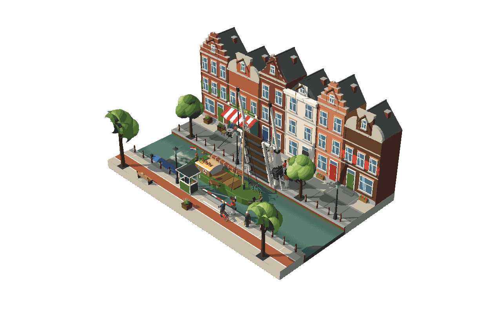

# De Ophaalbrug



A pixel-art diorama of an Amsterdam canal on a Saturday afternoon, built from
one sentence with the open-source [Diorama](https://github.com/sloemo01/diorama)
skill for coding agents, in Three.js. Everything is a pure function of `t`; a
40 s loop. No video model, no textures, no imported assets: every house, bike
and bitterbal is primitives in code.

**Watch it live:** <https://mister030.github.io/ophaalbrug-diorama/>
(`?t=20.7` freezes a frame). Or download [`ophaalbrug.html`](ophaalbrug.html):
one file, 0.8 MB, runs offline.

A white bascule bridge carries bikes over the canal until a tjalk with a tall
mast comes along. The keeper drops the booms, one cyclist in a suit brakes a
second too late, the leaf rises, the barge passes with the skipper and the
keeper waving at each other, the leaf comes down and the queue streams over.
On the café terrace the waiter brings a round and later the bitterballen.

## Run

```bash
npm i
node build.mjs            # dist/app.js, index.html, ophaalbrug.html (standalone)
python3 -m http.server 4180
```

Open `http://127.0.0.1:4180/`, or double-click `ophaalbrug.html` (works over
`file://`). `?t=20.7` freezes a frame, `?dither=0` switches the dither off.

## Beats

| t | Beat |
| --- | --- |
| 0–10 | bikes cross in both directions, the waiter brings two beers |
| 10.0 | keeper presses the button: red lights flash |
| 11.0–12.6 | booms come down; the late cyclist brakes at 12.7 and throws his hands up |
| 13.0–18.2 | leaf rises; the balance beams follow, the tie rods stay vertical |
| 20.7 | the mast passes under the beams; skipper and keeper wave |
| 26.0–31.0 | leaf lowers behind the barge; the moored sloop rides the wash |
| 31.6–33.0 | booms up; 33.1 the late one goes first, the queue follows |
| 34.5–40 | quiet seam: a walker, a last cyclist, the bitterballen get eaten |

## Systems and cast

- Bridge: leaf, two balance beams with ballast boxes, two tie rods solved per
  frame, two booms with flashing signals, keeper's booth with the buttons.
- Tjalk: 9 m hull with leeboards, furled sail, pennant and flag, geraniums on the
  cabin, the skipper's bike lashed to the foredeck, a wake behind the stern.
- Terrace: two tables, waiter with a tray, three guests, glass swaps and a
  basket of bitterballen that empties one ball at a time.
- Ten cyclists on five routes, one walker, two ducks, four trees, six canal
  houses with four gable types, café with awning and sign.

## QA

```bash
export CHROME_PATH="/Applications/Google Chrome.app/Contents/MacOS/Google Chrome"
export BASE_URL=http://127.0.0.1:4180/index.html
SHOTS="3.0:b1,12.7:b2,20.7:b3,28.5:b4,34.5:b5" QA_DIR=shots node qa/shoot.mjs
node qa/probe.mjs 20.7                                   # numbers + hero frame
node qa/probe.mjs 4.3 "-1.5,3.5,0.5:-5.8,0.9,-4.3" shots/terrace.png
LOOP=40 STEP=0.25 node qa/audit.mjs
ENTITIES='({ L: d.cast.riders.L.bike.group })' FROM=12 TO=16 node qa/frames.mjs
```

> `qa/audit.mjs` reports `MARGIN_LEAK` on this scene. It projects the slab at
> y ±0.6 only, so the 11 m gables and the raised leaf above it count as paper
> pixels. Every other check (early hide, fades, teleports, camera scale) passes.

See `DESIGN.md` for the design sheet, `refs/SOURCES.md` for the research log and
`CREDITS.md` (no imported assets).
